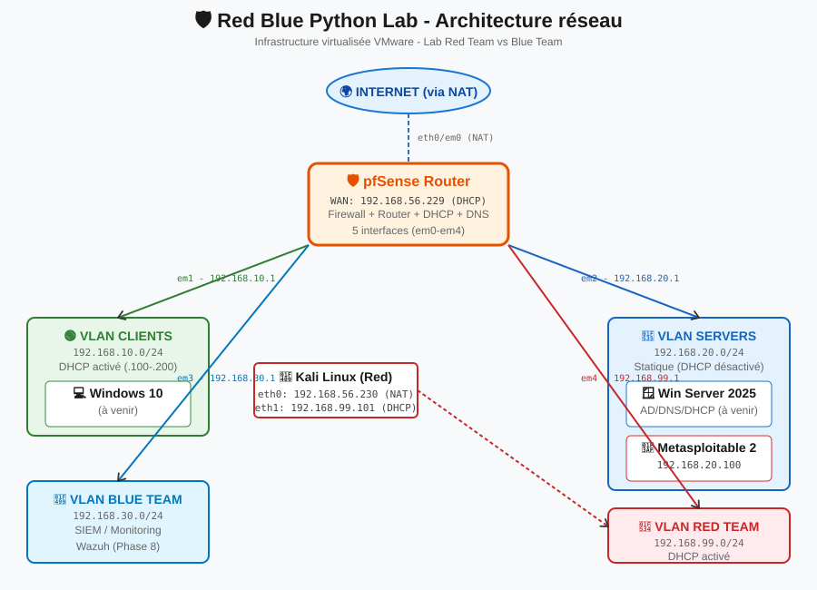

# 🌐 Architecture réseau du lab — redblue-python-lab
---

## 📐 Vue d'ensemble

Le lab reproduit **l'architecture d'une petite entreprise** (PME) avec :
- Un **routeur/firewall central** (pfSense)
- **4 zones réseau isolées** (VLANs)
- Un **attaquant** (Red Team) sur un VLAN dédié
- Des **cibles** réalistes (serveurs internes, postes clients)
- Une **future zone défense** (Blue Team) avec un SIEM

### Schéma visuel



---

## 🏗️ Composants détaillés

### 🛡️ pfSense — le routeur central

**Rôle** : routeur, firewall, serveur DHCP, serveur DNS, serveur NTP

**Pourquoi pfSense ?**
- Open-source (gratuit, code auditable)
- Basé FreeBSD (OS robuste connu pour la sécurité)
- Utilisé en production par des dizaines de milliers d'entreprises
- Interface web intuitive + API REST
- Standard de l'industrie pour les labs cyber

**Spécifications VM** :
- 1 vCPU / 2 cores
- 1 Go RAM
- 8 Go disque (ZFS)
- **5 cartes réseau** (une par VLAN + WAN)

**Interfaces** :

| Interface | VMnet | Subnet | Rôle |
|---|---|---|---|
| WAN (em0) | VMnet8 (NAT) | 192.168.56.0/24 | Sortie internet via NAT VMware |
| LAN (em1) | VMnet10 (Clients) | 192.168.10.0/24 | Postes utilisateurs |
| OPT1 / SERVERS (em2) | VMnet3 (Servers) | 192.168.20.0/24 | Serveurs internes |
| OPT2 / BLUE (em3) | VMnet4 (Blue) | 192.168.30.0/24 | Outils défensifs |
| OPT3 / RED (em4) | VMnet5 (Red) | 192.168.99.0/24 | Attaquant (Red Team) |

**IP de pfSense sur chaque réseau** : toujours `.1` (convention standard "passerelle en .1").

---

### 🟢 VLAN CLIENTS — 192.168.10.0/24

**Rôle** : simuler les **postes utilisateurs** d'une entreprise.

**Composants prévus** :
- Windows 10 (poste employé)
- Potentiellement plus tard : poste Linux (Ubuntu desktop)

**Configuration DHCP** :
- **Activé** sur pfSense
- Plage : 192.168.10.100 → 192.168.10.200
- Les 100 premières IPs (.1 à .99) réservées pour du statique si besoin

**Pourquoi DHCP activé** : dans une entreprise réelle, les postes de travail reçoivent toujours leur IP via DHCP (plus simple à gérer à grande échelle).

---

### 🔵 VLAN SERVERS — 192.168.20.0/24

**Rôle** : héberger les **serveurs internes** critiques.

**Composants prévus** :
- Windows Server 2025 (Active Directory, DNS, DHCP interne possible, IIS)
- Metasploitable 2 (cible vulnérable pour s'entraîner)
- Éventuellement Ubuntu Server (services Linux)

**Configuration DHCP** :
- **DÉSACTIVÉ** sur pfSense
- Chaque serveur reçoit une **IP statique** attribuée manuellement

**Pourquoi DHCP désactivé** : les serveurs doivent avoir des IPs **fixes et prédictibles**. Un serveur AD dont l'IP change toutes les 24h = chaos complet (tous les clients perdent le serveur). **Règle d'or : serveurs = statique, clients = DHCP.**

**Plan d'adressage statique** :

| VM | IP | Rôle |
|---|---|---|
| Windows Server 2025 | 192.168.20.10 | AD/DNS/DHCP interne/IIS |
| Metasploitable 2 | 192.168.20.100 | Cible vulnérable |

---

### 💙 VLAN BLUE TEAM — 192.168.30.0/24

**Rôle** : accueillir les **outils défensifs** (détection, monitoring, SIEM).

**Composants prévus** (Phase 9) :
- **Wazuh** (SIEM open-source) → corrélation de logs + détection
- Potentiellement Suricata (IDS) ou Zeek

**Configuration DHCP** :
- Activé pour simplicité

**Pourquoi un VLAN dédié** : la Blue Team doit être **isolée** des attaquants. Si Red compromet un poste Clients, il ne doit pas pouvoir atteindre les outils de monitoring sans traverser pfSense.

---

### 🔴 VLAN RED TEAM — 192.168.99.0/24

**Rôle** : abriter **l'attaquant** (pentester).

**Composants** :
- Kali Linux (dans ce lab)

**Configuration DHCP** :
- Activé (Kali reçoit son IP automatiquement)
- Plage : 192.168.99.100 → 192.168.99.200

**Pourquoi un VLAN dédié** : permet de simuler **différents scénarios d'attaque** :
- Attaquant externe (via WAN → NAT inbound simulé)
- Attaquant interne (déjà sur Red = compromis d'un fournisseur par exemple)
- Lateral movement (Red → Clients → Servers)

---

## 🔥 Règles firewall pfSense

### Principe général : **"Deny by default, allow by exception"**

Par défaut, pfSense **bloque TOUT trafic entrant** sur toutes les interfaces. Chaque flux doit être explicitement autorisé par une règle.

### État actuel des règles

| Interface | Règles actives | Objectif |
|---|---|---|
| WAN | 2 auto (block private + bogon) | Protection anti-spoofing standard |
| LAN | 1 auto (Allow LAN to any) | Postes clients → tout accès |
| SERVERS | 0 règle utilisateur | Tout bloqué (à configurer) |
| BLUE | 0 règle utilisateur | Tout bloqué (à configurer) |
| RED | 1 règle : `Allow RED to anywhere (full outbound)` | Attaquant = full access |

### À venir

Pour que Kali (Red) puisse attaquer Metasploitable (Servers), il faudra :
- **Firewall → Rules → RED → Add**
- Pass / Any / Source RED subnets / Destination SERVERS subnets

Puis pour simuler des défenses, on **restreindra** progressivement cette règle (bloquer SSH, ne garder que HTTP, etc.) pour durcir le lab.

---

## 🖥️ Spécifications des VMs

### pfSense Router

| Composant | Valeur |
|---|---|
| OS | pfSense CE 2.7.2 (FreeBSD 14) |
| vCPU | 1 processeur / 2 cores |
| RAM | 1 Go |
| Disque | 8 Go (ZFS stripe) |
| Cartes réseau | 5 (WAN + 4 LANs) |
| Dossier | `C:\Users\Anthony\VMs\Machines\pfSense-Router\` |

### Kali Linux (Red Team)

| Composant | Valeur |
|---|---|
| OS | Kali Linux 2026.3 |
| vCPU | 1 processeur / 2 cores |
| RAM | 4 Go |
| Disque | 50 Go |
| Cartes réseau | 2 (NAT + Red) |
| User | `anthony` |
| Dossier | `C:\Users\Anthony\VMs\Machines\Kali-Linux-Red\` |

### Metasploitable 2 (cible)

| Composant | Valeur |
|---|---|
| OS | Ubuntu 8.04 (volontairement ancien) |
| vCPU | 1 |
| RAM | 512 Mo |
| Disque | 8 Go (pré-fait) |
| Cartes réseau | 1 (Servers) |
| User | `msfadmin` / `msfadmin` (défaut) |
| Dossier | `C:\Users\Anthony\VMs\Machines\Metasploitable2-Linux\` |

---

## 🌍 Topologie des flux réseau

### Flux actuellement autorisés

```
[Kali Red] --(eth0 NAT)--> [VMware NAT] --> Internet
[Kali Red] --(eth1 RED)--> [pfSense em4] --(règle Allow RED → any)--> partout
```

### Flux à ouvrir pour la Phase 2

```
[Kali Red] --(eth1 RED)--> [pfSense em4 → em2 SERVERS]
    ↓ (après règle "Allow RED to SERVERS")
[Metasploitable] (192.168.20.100)
```

### Flux à durcir plus tard (Phase 10)

```
Tous les flux cross-VLAN (sauf admin pfSense) → blocage par défaut
Règles exceptionnelles bien documentées
Logs activés pour surveillance Blue Team
```

---

## 🔐 Credentials (NE JAMAIS pousser sur GitHub)

**Un fichier séparé `credentials.md` ignoré par `.gitignore` contient les mots de passe.**

Convention de nommage utilisée :
- pfSense admin : `admin` / [stocké localement]
- Kali : `anthony` / [stocké localement]
- Metasploitable : `msfadmin` / `msfadmin` (défaut, connu publiquement)

---

## 📚 Références utilisées

- **pfSense Documentation** : https://docs.netgate.com/pfsense/
- **Kali Linux Documentation** : https://www.kali.org/docs/
- **Metasploitable 2 Exploitability Guide** : https://docs.rapid7.com/metasploit/metasploitable-2/
- **RFC 1918** (plages d'IP privées) : https://datatracker.ietf.org/doc/html/rfc1918

---

## 🎯 Évolution prévue de l'architecture

### Phase 1-2 (actuel)
- Lab minimum viable : pfSense + Kali + Metasploitable
- Objectif : **premier script Python attaque**

### Phase 3-5
- Ajout Windows Server 2025 (AD/DNS/DHCP) sur Servers
- Ajout Windows 10 client sur Clients
- Scripts Python : port scanner, banner grabbing, sniffer

### Phase 6-8
- Attaques AD (Kerberoasting, password spraying)
- Attaques Web (DVWA en Docker)
- Attaques MITM (ARP spoofing)

### Phase 9-11
- Installation Wazuh sur Blue
- Durcissement pfSense (règles strictes)
- Rapport final + portfolio